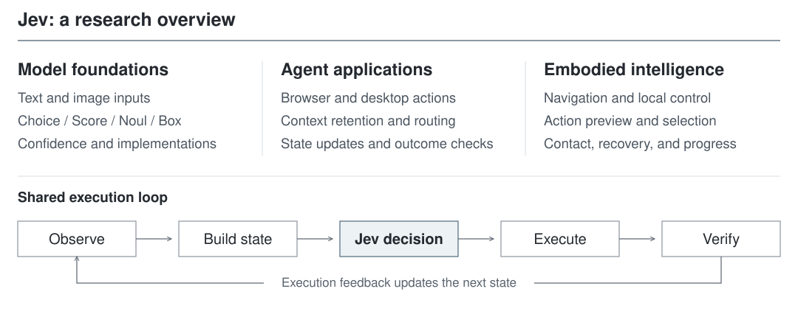
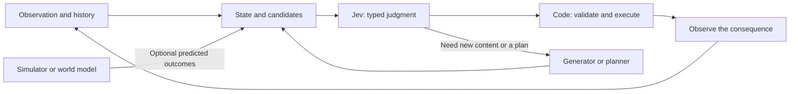

# Awesome Jev

**English** | [简体中文](README_zh.md)

> **Jev: Structured Decision Models for Agents and Embodied Intelligence**
>
> Connecting typed judgments with state representation, action selection, and execution feedback.

<p align="center">
  
</p>

[](LICENSE)
[](#scope)
[](CONTRIBUTING.md)

<!-- BEGIN COUNTS -->
**37 curated resources** · Foundations 16 · Agents 4 · Embodied AI 17
<!-- END COUNTS -->

[Survey](docs/report.md) · [Multimodal interfaces](docs/multimodal.md) · [Community implementations](docs/community-models.md) · [Evaluation](docs/evaluation.md)

## Contents

- [Introduction](#introduction)
- [Research scope](#scope)
- [Taxonomy](#three-directions)
- [A shared decision loop](#decision-loop)
- [1. Model foundations](#foundations)
- [2. Agent applications](#agents)
- [3. Embodied intelligence](#embodied)
- [Evaluation and benchmarks](#evaluation)
- [Reading routes](#reading-routes)
- [Open questions](#open-questions)
- [Repository layout](#repository-layout)
- [Contributing and acknowledgments](#contributing)

<a id="introduction"></a>
## Introduction

Tool use, context filtering, navigation, and local control involve many decisions with bounded answer spaces. Jev expresses these as typed judgments over a shared state. **Choice, Score, Noul, and Box** return candidate selections, ordinal scores, proposition probabilities, and image locations, allowing model outputs to inform program branches, candidate ranking, and execution checks.

The value of a local judgment depends on its place in a complete system. State representation determines the available evidence, candidate construction determines the available actions, and execution feedback determines when to correct or replan. This survey connects **model foundations, agent applications, and embodied intelligence** through their interfaces, representative methods, open-source projects, and evaluations.

<a id="scope"></a>
## Research scope

- **Models and interfaces**: System One, shared state, typed outputs, multimodal judgments, confidence, and community models.
- **Software agents**: Browser and desktop actions, tool selection, context management, model routing, and continuous decisions.
- **Embodied intelligence**: Visual navigation, action simulation, skill selection, local control, action reuse, and physical feedback.
- **Evaluation and related work**: Decision quality, task success, end-to-end cost, and relevant mechanisms in closed-loop VLA and world models.

TypeSafe provides official Jev capabilities through a hosted API. Community implementations such as OpenJev, Visual Jev, NanoJev, and CLM use their own models and training methods. The sections below distinguish their mechanisms, results, and operating conditions.

<a id="three-directions"></a>
## Taxonomy

| Direction | Central question | Main subjects | Detailed guide |
| --- | --- | --- | --- |
| **Model foundations** | What does Jev return, and when should a decision be trusted? | Text/image state, Choice / Score / Noul / Box, calibration, community models | [Foundations](docs/foundations.md) |
| **Agent applications** | Does a faster judgment improve a complete software task? | Browser and desktop actions, context retention, routing, state freshness | [Agents](docs/agents.md) |
| **Embodied intelligence** | Does a selected action produce the intended physical progress? | Navigation, simulation-assisted selection, local control, action reuse | [Embodied AI](docs/embodied.md) |

These directions share an interface but require different evaluation. Classification accuracy, browser task completion, and manipulation success are not interchangeable scores.

<a id="decision-loop"></a>
## A shared decision loop



The model returns a judgment or location. The application validates it, decides what to execute, and checks whether the observed result satisfies the task. A typed answer can still be the wrong decision.

<a id="foundations"></a>
## 1. Model foundations

**State → Questions → Typed answers → Program behavior.**

| Primitive | Output meaning | Example question |
| --- | --- | --- |
| **Choice** | A selected candidate and option probabilities | Continue, observe again, or replan? |
| **Score** | A probability distribution over ordered levels and an associated score | How much task progress is visible? |
| **Noul** | The probability that a proposition is true | Does the observation support successful completion? |
| **Box (1.14, experimental)** | One normalized target box and confidence | Where is the mug in the image? |

Questions in the same request share state and are evaluated independently. If one judgment depends on another answer, encode that dependency in the application. Choice / Score confidence is derived from probabilities; Box returns localization confidence separately. Evaluate correctness, calibration, and localization quality independently.

**Both Jev 1.13 and 1.14 accept images; Box requires 1.14.** Images can enter state, instructions, and criteria. Send `TypeSafe-Danger-Zone-Images: true`; images and Box remain experimental. Box returns a rectangle even for absent targets, so pair it with a presence check. See the [multimodal guide](docs/multimodal.md).

<!-- BEGIN FOUNDATIONS -->
| Resource | Role / takeaway | Evidence and scope |
| --- | --- | --- |
| [Introducing System One Models & Jev](https://typesafe.ai/blog/introducing-system-one-models-and-jev) | The System One positioning, typed decisions, and vendor descriptions of sampling and RLCD. | **Official** · Architecture and training are vendor descriptions; workflow comparisons are vendor-reported. |
| [TypeSafe Quick Start](https://docs.typesafe.ai/introduction/quickstart) | State, questions, and typed answers in one request. | **Official** · Use the current SDK/API documentation for actual integration. |
| [State](https://docs.typesafe.ai/concepts/state) | Build shared textual, structured, or image-referencing state for independent questions. | **Official** · Same-request answers are not a sequential reasoning chain. |
| [Choice](https://docs.typesafe.ai/primitives/choice) | Choose among predefined candidates with an option distribution. | **Official** · Missing candidates cannot be recovered by the selector. |
| [Score](https://docs.typesafe.ai/primitives/score) | Evaluate an ordered set of levels rather than generate an explanation. | **Official** · Levels must describe one interpretable dimension. |
| [Noul](https://docs.typesafe.ai/primitives/noul) | Return a probability for a yes/no proposition. | **Official** · Thresholds need task-specific validation; no separate native confidence field. |
| [Confidence](https://docs.typesafe.ai/confidence) | Explain how Choice and Score confidence is derived from their distributions. | **Official** · Distribution concentration does not guarantee factual correctness or task success. |
| [Evaluating and Benchmarking the System One Model Jev](https://arxiv.org/abs/2609.37647) | Independent evaluation across 37 datasets, including accuracy, calibration, and selective prediction. | **Paper** · Preprint; conclusions depend on model version, prompts, baselines, and answer coverage. |
| [Images: multimodal state and criteria](https://docs.typesafe.ai/go/images) | Images in shared state, instructions, and answer criteria; Jev 1.13 and 1.14 support image input. | **Official** · Experimental; requires the images header and documented image/request limits. |
| [Box: image localization](https://docs.typesafe.ai/go/box) | Jev 1.14 returns one normalized target box per question, alongside confidence. | **Official** · Experimental; absent targets still produce boxes, so validate presence separately. |
| [Can Jev See? A 48-image COCO evaluation](https://rohitghumare.com/blog/typesafe-870m-can-jev-see/) | Community comparison of image Noul, word/picture Choice, Score, and Box across two Jev versions. | **Demo** · 48 selected images, repeated calls and imperfect labels; author-reported, not a full COCO benchmark. |
| [OpenJev](https://github.com/razorback16/openjev) | Read and normalize candidate-token probabilities at diffusion answer slots using existing weights. | **Project** · Independent implementation; grouping, rereads, and entropy confidence differ from official Jev. |
| [Visual Jev: code and released adapter](https://github.com/guanxuyu-sv/Visual-Jev) | Qwen3-VL answer-SFT LoRA, existing LM-head readout, and shared visual-prefix batching. | **Project / Paper** · Community model; quickstart supports Choice with 2–16 options, not the official multimodal API. |
| [Visual Jev: Accurate and Efficient Decisions from Shared Visual Context](https://arxiv.org/abs/2609.25845) | Separates training accuracy gains from shared-image execution and amortized throughput. | **Paper** · Four forced-choice tasks, one backbone family, one timing machine; 5.7 ms/question is not request latency. |
| [NanoJev](https://github.com/TianyuCodings/NanoJev) | Qwen3-0.6B and a shared decision head jointly trained for four games. | **Project / Demo** · unified-games-v1 selects step 400; task-specific training and reported tests do not establish a general replacement. |
| [Contrastive Language Models (CLM)](https://github.com/Contrastive-LM/CLM) | Frozen Qwen3-8B plus contrastively trained state/action projections and independently cached candidates. | **Project** · Text encoder in reviewed release; visual support is roadmap work and reported speedups are task-specific. |
<!-- END FOUNDATIONS -->

Read [foundations](docs/foundations.md) for interfaces, confidence, and evaluation; [multimodality](docs/multimodal.md) for images, Box, candidate-design examples, and the community COCO report; and [community models](docs/community-models.md) for OpenJev, Visual Jev, NanoJev, and CLM training/execution routes. [Request examples](examples/README.md) cover structured state and images.

<a id="agents"></a>
## 2. Agent applications

**Observe → Represent → Decide → Execute → Verify.**

The four case studies cover different parts of an agent: actions on a web page, actions on a desktop, retention of internal history, and decisions against a continuously changing external state. In each case, candidate extraction and execution are substantial parts of the system.

<!-- BEGIN AGENTS -->
| Resource | Role / takeaway | Evidence and scope |
| --- | --- | --- |
| [jev-ultrafast](https://github.com/browser-use/jev-ultrafast) | Select browser operations and numbered DOM targets; use a separate generator for free text. | **Project / Demo** · One flight-search task and engineering timings do not establish cross-site reliability. |
| [typesafe-computer-use](https://github.com/awlevin/typesafe-computer-use) | OCR and accessibility build state; Jev selects an action and target reference. | **Project / Demo** · Perception pipelines differ in the reported comparison; compare full-step and task costs. |
| [fast-jev-compaction](https://github.com/tamaratran/fast-jev-compaction) | Use paired retention judgments to keep, truncate, or remove tool interactions. | **Project** · Concept animations and mock demos are not measurements of downstream task quality. |
| [jev-trader](https://github.com/jarrodwatts/jev-trader) | Study decision freshness in a continuous market-state and execution loop. | **Project / Demo** · The reviewed public demo is dry-run/mock; no live-profit claim. |
<!-- END AGENTS -->

The [agent guide](docs/agents.md) compares model and program responsibilities, stale-target failures, context deletion, and end-to-end timing. It also proposes controlled experiments for evidence selection and model routing.

<a id="embodied"></a>
## 3. Embodied intelligence

**Observe physical state → Select an executable option → Act → Measure physical progress.**

| Subdirection | Jev's decision | What the rest of the system supplies |
| --- | --- | --- |
| Spatial cognition | Waypoint, direction, target, or stop | Perception, spatial relationships, candidate routes |
| Action preview | Skill or atomic input given predicted consequences | Branch simulation or another explicit predictor |
| Local behavior | Intent, Cartesian direction, gripper state | Kinematics, servo control, constraints, contact sensing |
| Execution feedback | Reuse an action suffix or regenerate | An action generator, execution traces, fresh observations |

The robot cases studied here typically provide Jev with textual or structured observations. Those historical implementations typically process images, geometry, and contact signals in other modules; this does not imply that official Jev lacks image inputs. Simulation rollouts in jev-libero and the Stacker study use known simulators; they do not establish a Jev integration with a learned world model.

<!-- BEGIN EMBODIED -->
| Resource | Role / takeaway | Evidence and scope |
| --- | --- | --- |
| [NavJev](https://arxiv.org/abs/2609.34969) | Compress visual navigation into action-centered waypoint descriptions and history. | **Paper / Demo** · Reported 100-task simulation comparison; input design and non-reasoning baselines matter. |
| [Can Jev Nav / Nav Arena](https://research.dimensional.org/system-one-navigation/) | Navigation actions from structured spatial state, with broad system comparisons. | **Project** · Main evaluation, short-range subset, representation study, and real-robot demo are different sets. |
| [Code Owns the Simulation, Jev Owns the Evaluation](https://arxiv.org/abs/2610.01834) | Separate programmatic skill simulation from language-conditioned skill selection. | **Paper** · Changing torque to skills also changes control assistance; this uses a known simulator. |
| [jev-libero](https://github.com/Dimweaker/jev-libero) | Use short branch simulations to choose intent, action family, and atomic input. | **Project / Demo** · Passing examples are not a standard LIBERO benchmark score or a learned world-model result. |
| [EmbodiedJev](https://github.com/FBddcz/embodied-jev) | Combine visual planning with local direction and gripper decisions. | **Project / Demo** · Small development runs; track object progress as well as end-effector motion. |
| [RoboJEV](https://github.com/lykycy123/RoboJEV) | Two-stage intent and XYZ/gripper selection in MuJoCo manipulation. | **Project** · The reported rule baseline completes more tasks; whole-arm feasibility remains a control concern. |
| [RoboICL — Jev action-reuse study](https://arxiv.org/abs/2609.34261) | Decide whether to reuse the remaining action suffix or regenerate it. | **Paper** · Jev substudy: two development tasks, five layouts each; main-framework videos are separate. |
| [GeoLingo (formerly DepthJev)](https://github.com/ZJUCQR/GeoLingo) | Translate metric depth and object detections into text facts for Jev navigation decisions. | **Project** · Author-reported 300-episode EB-Navigation evaluation; target-type errors are prominent on visual-appearance tasks. |
| [jev-robotic-arm-benchmark](https://github.com/Dililianxice/jev-robotic-arm-benchmark) | Compare Jev, a structured LLM selector, and rules through the same xArm interface. | **Project** · Three nearby starts and 16 paired probes; API waiting pauses simulation. |
| [jev-arm-lab](https://github.com/Vankleben/jev-arm-lab) | Study skill choice and the mismatch between grasp judgments and physical attachment. | **Project** · Decision events within one episode are correlated, not independent task trials. |
| [Robots World](https://github.com/DanMcInerney/robots-world) | Explore state aging, tracking, and feedback while the environment keeps moving. | **Project / Demo** · Small trials and post-hoc criteria must remain distinguishable. |
| [jev-drone](https://github.com/RomanSlack/jev-drone) | Separate slower semantic decisions from faster flight control and constraints. | **Project / Demo** · Simulation; architecture frequencies are project settings, not general Jev guarantees. |
| [jev-wam](https://github.com/Alpha-Harper-Franklin/jev-wam) | Propose choosing between plan reuse, observation, and expensive prediction. | **Proposal** · Design-stage material in the reviewed snapshot, without completed integration results. |
| [Awesome Closed-Loop VLA](https://github.com/ZJU-OmniAI/Awesome-Closed-Loop-VLA) | A three-loop framework for execution, prediction, and learning. | **Background** · Conceptual connection; the surveyed methods do not all use Jev. |
| [Awesome World Model](https://github.com/ZJU-OmniAI/Awesome-World-Model) | World-model foundations, executability, and evaluation resources. | **Background** · Resource index; not a Jev world-model implementation. |
| [V-JEPA 2](https://arxiv.org/abs/2506.09985) | Action-conditioned latent prediction provides a reference for learned planning models. | **Background / Paper** · No Jev integration is established by this paper. |
| [LIBERO](https://github.com/Lifelong-Robot-Learning/LIBERO) | Robot manipulation environment and task suites used by several examples. | **Background / Project** · A custom task subset is not the official suite evaluation. |
<!-- END EMBODIED -->

The [embodied guide](docs/embodied.md) distinguishes the seven main cases, author-reported results, and the three proposed experiments: execution correction, active observation, and selective prediction.

<a id="evaluation"></a>
## Evaluation and benchmarks

Catalog labels distinguish **Official**, **Paper**, **Project**, **Demo**, **Proposal**, and **Background**. A paper can be a preprint; a project can have only small development runs; a background resource need not use Jev at all. See [label definitions](data/README.md).

Compare systems at a fixed task boundary. Hold the state, candidate set, executor, and task initialization constant where the research question allows it. Report task success together with total cost, wall-clock time, retries, and failures. Separate model latency from perception, simulation, and execution time.

[Evaluation guide](docs/evaluation.md) · [Evidence and source notes](docs/source-notes.md)

<a id="reading-routes"></a>
## Reading routes

1. **Understand the interface:** State → Choice / Score / Noul / Box → Confidence → image evidence limits → community models and independent evaluation.
2. **Build a software agent:** jev-ultrafast → typesafe-computer-use → fast-jev-compaction → full-task evaluation.
3. **Study robotics:** RoboJEV → jev-libero → EmbodiedJev → RoboICL's action-reuse substudy.
4. **Connect to closed-loop VLA:** execution feedback → prediction validity → when to replan or request a world-model rollout.

<a id="open-questions"></a>
## Open questions

- **Decision reliability:** which probability statistic and threshold transfer to new tasks and candidate sets?
- **Information quality:** how do original images, crops, textual summaries, and combined state change the available evidence and decisions?
- **Computation allocation:** when does an extra observation or expensive model call pay for itself?
- **Feedback quality:** how can the system distinguish command execution from task progress?
- **Long-term adaptation:** can logged failures improve state construction and decision policies under a fixed evaluation protocol?

The [research roadmap](docs/roadmap.md) describes falsifiable experiments across all three directions. These are proposals, not reported results.

<a id="repository-layout"></a>
## Repository layout

```text
README.md / README_zh.md       Bilingual overview and generated resource tables
assets/overview.svg           Original vector overview
docs/report.md / report_zh.md  Bilingual technical survey
docs/                         Topic guides, evaluation, and research roadmap
data/resources.json           Bilingual resource catalog
examples/                     Illustrative request and interpretation
scripts/                      Catalog generation and repository validation
.github/                      Contribution templates and CI
```

No installation or API key is needed to read the repository. To maintain it, use Python 3.10 or newer:

```bash
python3 scripts/update_catalog.py
python3 scripts/check_repository.py
```

<a id="contributing"></a>
## Contributing and acknowledgments

Add a resource, correct a claim, or contribute a reproducible case through [the contribution guide](CONTRIBUTING.md). Summaries should identify the decision interface and the strongest supporting evidence, including negative results.

We thank the authors of the linked papers, projects, and public records. Original content in this repository is licensed under [Apache-2.0](LICENSE); third-party materials retain their respective licenses.

For citation metadata, see [CITATION.cff](CITATION.cff).
