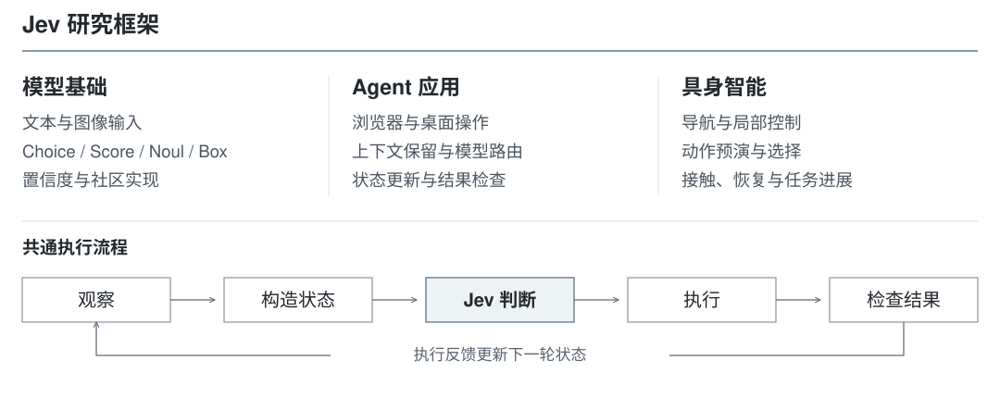
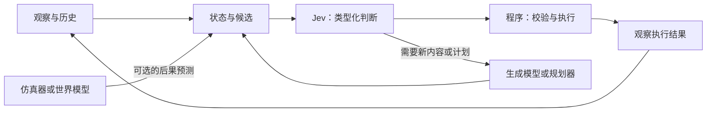

# Awesome Jev

[English](README.md) | **简体中文**

> **Jev：结构化决策模型及其在 Agent 与具身智能中的应用**
>
> 从类型化判断出发，梳理状态表示、动作选择与执行反馈之间的关系。

<p align="center">
  
</p>

[](LICENSE)
[](#scope)
[](CONTRIBUTING.md)

<!-- BEGIN COUNTS -->
**37 项精选资源** · 模型基础 16 · Agent 应用 4 · 具身智能 17
<!-- END COUNTS -->

[技术综述](docs/report_zh.md) · [多模态接口](docs/multimodal_zh.md) · [社区实现](docs/community-models_zh.md) · [评测方法](docs/evaluation_zh.md)

## 目录

- [简介](#introduction)
- [研究范围](#scope)
- [技术分类](#three-directions)
- [共享的决策闭环](#decision-loop)
- [一、模型基础](#foundations)
- [二、Agent 应用](#agents)
- [三、具身智能](#embodied)
- [评测与基准](#evaluation)
- [阅读路线](#reading-routes)
- [开放问题](#open-questions)
- [仓库结构](#repository-layout)
- [贡献与致谢](#contributing)

<a id="introduction"></a>
## 简介

工具调用、上下文筛选、导航和局部控制中，许多决策都具有明确的答案范围。Jev 将这些问题组织为共享状态上的类型化判断，通过 **Choice、Score、Noul、Box** 返回候选选择、等级评分、命题概率和图像定位。这样的接口使模型输出能够直接参与程序分支、候选排序和执行检查。

局部判断的价值取决于它如何进入完整系统：状态表示决定模型能看到什么，候选构造决定模型能选择什么，执行反馈决定下一步是否需要纠错或重新规划。本综述围绕 **模型基础、Agent 应用、具身智能** 三个方向，连接接口设计、代表方法、开源项目与评测结果，讨论快速判断在真实任务中的作用与局限。

<a id="scope"></a>
## 研究范围

- **模型与接口**：System One、共享状态、类型化输出、多模态判断、置信度与社区模型。
- **软件 Agent**：浏览器与桌面操作、工具选择、上下文管理、模型路由和连续决策。
- **具身智能**：视觉导航、动作预演、技能选择、局部控制、动作复用与物理反馈。
- **评测与相关研究**：判断质量、任务成功率、端到端开销，以及闭环 VLA 和世界模型中的相关机制。

Jev 的官方能力由 TypeSafe 的托管 API 提供；OpenJev、Visual Jev、NanoJev 和 CLM 等社区实现采用各自的模型与训练方法。下文分别介绍它们的机制、结果与适用条件。

<a id="three-directions"></a>
## 技术分类

| 方向 | 核心问题 | 主要内容 | 专题导读 |
| --- | --- | --- | --- |
| **模型基础** | Jev 返回什么，什么时候可以信任判断？ | 图文 State、Choice / Score / Noul / Box、校准与社区实现 | [模型基础](docs/foundations_zh.md) |
| **Agent 应用** | 更快的局部判断能否改善完整软件任务？ | 浏览器、桌面操作、上下文保留、路由与状态时效 | [Agent 应用](docs/agents_zh.md) |
| **具身智能** | 选出的动作是否产生了预期的物理进展？ | 导航、预演选择、局部控制与动作复用 | [具身智能](docs/embodied_zh.md) |

三个方向共享判断接口，但需要不同的评价方式。分类准确率、浏览器任务完成率与机器人操作成功率不能混为同一指标。

<a id="decision-loop"></a>
## 共享的决策闭环



模型返回判断或位置；程序校验结果、决定如何执行，并验证结果是否满足任务。类型正确的答案仍可能是错误决策。

<a id="foundations"></a>
## 一、模型基础

**State → Questions → 类型化答案 → 程序行为。**

| 接口 | 输出含义 | 问题示例 |
| --- | --- | --- |
| **Choice** | 所选候选及选项概率 | 继续、重新观察，还是重新规划？ |
| **Score** | 有序等级的概率分布及对应分数 | 当前观察显示多大程度的任务进展？ |
| **Noul** | 某个命题为真的概率 | 观察是否支持任务已经完成？ |
| **Box（1.14，实验能力）** | 一个目标的归一化边界框与 confidence | 图像中的杯子在哪里？ |

同一请求中的问题共享状态、独立求值。若后一个判断依赖前一个答案，应在程序中显式组织依赖。Choice / Score confidence 来自输出概率；Box 另返回定位置信度。实际正确率、校准与定位质量需独立验证。

**Jev 1.13 和 1.14 均支持图像，Box 需要 1.14。** 图像可进入状态、题干和候选，需发送 `TypeSafe-Danger-Zone-Images: true`；图像和 Box 仍为实验能力。目标不存在时 Box 也会返回框，应搭配存在性判断。详见[多模态导读](docs/multimodal_zh.md)。

<!-- BEGIN FOUNDATIONS -->
| 资源 | 作用与要点 | 证据及适用范围 |
| --- | --- | --- |
| [Introducing System One Models & Jev](https://typesafe.ai/blog/introducing-system-one-models-and-jev) | System One 定位、类型化判断，以及官方对采样与 RLCD 的介绍。 | **官方资料** · 架构与训练来自官方介绍；工作流对照属于官方自测。 |
| [TypeSafe Quick Start](https://docs.typesafe.ai/introduction/quickstart) | 一次请求中的 State、Questions 与类型化响应。 | **官方资料** · 实际接入以当前 SDK/API 文档为准。 |
| [State](https://docs.typesafe.ai/concepts/state) | 为独立问题构造共享文本、结构化内容或图像引用状态。 | **官方资料** · 同批问题的答案不构成顺序依赖链。 |
| [Choice](https://docs.typesafe.ai/primitives/choice) | 从预定义候选中选择，并返回选项概率分布。 | **官方资料** · 选择器不能选出候选集中不存在的动作。 |
| [Score](https://docs.typesafe.ai/primitives/score) | 在有序等级上作判断，返回等级分布与分数。 | **官方资料** · 等级应表达同一个可解释维度。 |
| [Noul](https://docs.typesafe.ai/primitives/noul) | 对二值命题返回“是”的概率。 | **官方资料** · 阈值需按任务验证；原生响应没有独立 confidence 字段。 |
| [Confidence](https://docs.typesafe.ai/confidence) | 解释 Choice 与 Score 的 confidence 如何由概率分布计算。 | **官方资料** · 分布集中不保证事实正确或任务成功。 |
| [Evaluating and Benchmarking the System One Model Jev](https://arxiv.org/abs/2609.37647) | 覆盖 37 个数据集的独立评估，讨论准确率、校准和选择性预测。 | **论文** · 预印本；结论受模型版本、提示、基线与回答覆盖率约束。 |
| [Images: multimodal state and criteria](https://docs.typesafe.ai/go/images) | 图像进入共享状态、题干与候选；Jev 1.13 和 1.14 均支持图片。 | **官方资料** · 实验能力；需启用图像请求头并遵守图像及请求大小限制。 |
| [Box: image localization](https://docs.typesafe.ai/go/box) | Jev 1.14 每题返回一个目标的归一化边界框及 confidence。 | **官方资料** · 实验能力；不存在的目标也会返回框，需另做存在性校验。 |
| [Can Jev See? A 48-image COCO evaluation](https://rohitghumare.com/blog/typesafe-870m-can-jev-see/) | 社区对照两个 Jev 版本的图像 Noul、文字／图片 Choice、Score 与 Box。 | **演示** · 48 张筛选图像、重复调用及不完整标签；作者报告，不是完整 COCO 基准。 |
| [OpenJev](https://github.com/razorback16/openjev) | 使用现成权重，在扩散答案槽读取候选 token 概率并归一化。 | **项目** · 独立实现；问题分组、追加读取及熵置信度与官方 Jev 不同。 |
| [Visual Jev: code and released adapter](https://github.com/guanxuyu-sv/Visual-Jev) | Qwen3-VL 答案监督 LoRA、原 LM head 概率读出与视觉前缀共享批处理。 | **项目 / 论文** · 社区模型；quickstart 支持 2–16 候选的 Choice，不等同官方多模态 API。 |
| [Visual Jev: Accurate and Efficient Decisions from Shared Visual Context](https://arxiv.org/abs/2609.25845) | 区分训练带来的准确率变化与共享图像计算带来的摊销吞吐量变化。 | **论文** · 四项候选选择任务、一个模型家族和单机计时；5.7 ms/题不是单次请求延迟。 |
| [NanoJev](https://github.com/TianyuCodings/NanoJev) | 共同训练 Qwen3-0.6B 与共享决策头，覆盖四款游戏。 | **项目 / 演示** · unified-games-v1 选用第 400 步权重；专门训练与作者测试不证明通用替代能力。 |
| [Contrastive Language Models (CLM)](https://github.com/Contrastive-LM/CLM) | 冻结 Qwen3-8B，对比训练状态／动作投影头，并独立缓存候选。 | **项目** · 审阅版本为文本编码器，视觉支持仍属路线图；作者加速比受任务设置限制。 |
<!-- END FOUNDATIONS -->

[模型基础](docs/foundations_zh.md)解释接口、置信度与基础评测；[多模态](docs/multimodal_zh.md)整理图像输入、Box、候选设计实例和社区 COCO 报告；[社区实现](docs/community-models_zh.md)比较 OpenJev、Visual Jev、NanoJev、CLM 的训练与推理路线。[请求示例](examples/README.md)包含结构化状态和图像两种形式。

<a id="agents"></a>
## 二、Agent 应用

**观察 → 状态表示 → 判断 → 执行 → 验证。**

四个案例分别涉及网页动作、桌面动作、内部历史保留，以及持续变化的外部状态。候选提取与实际执行在每个系统中都承担了重要工作。

<!-- BEGIN AGENTS -->
| 资源 | 作用与要点 | 证据及适用范围 |
| --- | --- | --- |
| [jev-ultrafast](https://github.com/browser-use/jev-ultrafast) | 选择浏览器操作与编号 DOM 目标，自由文本由辅助模型生成。 | **项目 / 演示** · 单个航班搜索任务与工程计时不足以证明跨网站可靠性。 |
| [typesafe-computer-use](https://github.com/awlevin/typesafe-computer-use) | OCR 与辅助功能接口构造状态，Jev 选择动作和目标编号。 | **项目 / 演示** · 作者对照的感知链路不同，应比较完整单步及任务开销。 |
| [fast-jev-compaction](https://github.com/tamaratran/fast-jev-compaction) | 通过调用与结果的保留判断，对工具交互作保留、截短或删除。 | **项目** · 概念动画与模拟演示不能作为后续任务质量的实测。 |
| [jev-trader](https://github.com/jarrodwatts/jev-trader) | 研究持续市场状态更新与执行循环中的判断时效。 | **项目 / 演示** · 所审阅公开演示为 dry-run/mock，不构成实盘收益证据。 |
<!-- END AGENTS -->

[Agent 导读](docs/agents_zh.md)比较模型与程序的职责，讨论目标过期、上下文误删、完整任务计时，并提出证据筛选与模型路由的对照实验。

<a id="embodied"></a>
## 三、具身智能

**观察物理状态 → 选择可执行选项 → 行动 → 测量物理进展。**

| 子方向 | Jev 的判断 | 系统其他模块提供什么 |
| --- | --- | --- |
| 空间认知 | 路点、方向、目标或停止 | 感知、空间关系、候选路线 |
| 动作预演 | 根据候选后果选择技能或原子输入 | 分支仿真或其他明确的预测器 |
| 局部行为 | 意图、笛卡尔方向、夹爪状态 | 运动学、伺服控制、约束与接触观测 |
| 执行反馈 | 复用动作后缀或重新生成 | 动作生成器、执行轨迹与最新观察 |

这里分析的机器人案例通常向 Jev 提供文本或结构化观察。这些历史实现通常由其他模块处理图像、几何与接触信号；这不代表官方 Jev 没有图像输入能力。jev-libero 与 Stacker 研究中的动作预演来自已知仿真器，尚不构成 Jev 与学习型世界模型联合工作的证据。

<!-- BEGIN EMBODIED -->
| 资源 | 作用与要点 | 证据及适用范围 |
| --- | --- | --- |
| [NavJev](https://arxiv.org/abs/2609.34969) | 将视觉导航压缩为以动作为中心的路点描述与历史。 | **论文 / 演示** · 作者报告的百任务仿真对照；需考虑输入设计与未开启推理的基线。 |
| [Can Jev Nav / Nav Arena](https://research.dimensional.org/system-one-navigation/) | 从结构化空间状态选择导航动作，并比较多套完整系统。 | **项目** · 主评测、短程子集、状态表示实验和实机演示属于不同样本。 |
| [Code Owns the Simulation, Jev Owns the Evaluation](https://arxiv.org/abs/2610.01834) | 将程序实现的技能模拟与语言条件下的技能选择分开。 | **论文** · 从力矩改为技能同时改变控制辅助；所用预测来自已知仿真器。 |
| [jev-libero](https://github.com/Dimweaker/jev-libero) | 利用短时分支仿真，依次选择意图、动作类别与原子输入。 | **项目 / 演示** · 通过示例不等于标准 LIBERO 成绩，也不等于学习型世界模型结果。 |
| [EmbodiedJev](https://github.com/FBddcz/embodied-jev) | 将视觉规划与局部方向、夹爪判断组合。 | **项目 / 演示** · 少量开发运行；应同时检查物体进展与末端运动。 |
| [RoboJEV](https://github.com/lykycy123/RoboJEV) | 在 MuJoCo 操作任务中进行意图与 XYZ/夹爪两级选择。 | **项目** · 作者报告中规则完成数更高；整臂可行性仍需控制层检查。 |
| [RoboICL — Jev action-reuse study](https://arxiv.org/abs/2609.34261) | 判断继续复用剩余动作，还是重新生成。 | **论文** · Jev 子实验为两项开发任务、各五个布局；主框架视频应分开解读。 |
| [GeoLingo (formerly DepthJev)](https://github.com/ZJUCQR/GeoLingo) | 将度量深度与目标检测结果转为文本事实，由 Jev 选择导航动作。 | **项目** · 作者报告的 300 回合 EB-Navigation 评测；视觉外观任务中的目标类型判断仍有较多错误。 |
| [jev-robotic-arm-benchmark](https://github.com/Dililianxice/jev-robotic-arm-benchmark) | 通过相同 xArm 接口比较 Jev、结构化 LLM 选择器和规则。 | **项目** · 三个近邻初态与 16 对请求；API 等待时仿真暂停。 |
| [jev-arm-lab](https://github.com/Vankleben/jev-arm-lab) | 研究技能选择，以及抓稳判断与真实持有状态的偏差。 | **项目** · 同一回合内的判断事件相关，不能当作独立任务样本。 |
| [Robots World](https://github.com/DanMcInerney/robots-world) | 探索环境持续运动时的状态过期、追踪和反馈。 | **项目 / 演示** · 小规模试验与事后判定标准需要明确区分。 |
| [jev-drone](https://github.com/RomanSlack/jev-drone) | 将较慢语义判断与较快飞行控制、约束检查分层。 | **项目 / 演示** · 仿真项目；架构频率是项目设置，不是 Jev 的通用性能保证。 |
| [jev-wam](https://github.com/Alpha-Harper-Franklin/jev-wam) | 提出在计划复用、补充观察与昂贵预测之间选择。 | **设想** · 所审阅版本处于设计阶段，尚无完成集成后的效果结果。 |
| [Awesome Closed-Loop VLA](https://github.com/ZJU-OmniAI/Awesome-Closed-Loop-VLA) | 执行、预测与学习三个闭环的统一框架。 | **背景工作** · 概念关联；综述中的方法并非都使用 Jev。 |
| [Awesome World Model](https://github.com/ZJU-OmniAI/Awesome-World-Model) | 世界模型基础、动作可执行性与评测资源。 | **背景工作** · 资源索引；不是 Jev 世界模型实现。 |
| [V-JEPA 2](https://arxiv.org/abs/2506.09985) | 动作条件潜空间预测为学习型规划模型提供参考。 | **背景工作 / 论文** · 该论文没有验证与 Jev 的联合方案。 |
| [LIBERO](https://github.com/Lifelong-Robot-Learning/LIBERO) | 多个案例使用的机器人操作环境与任务套件。 | **背景工作 / 项目** · 自定义任务子集不等同于官方完整套件评测。 |
<!-- END EMBODIED -->

[具身智能导读](docs/embodied_zh.md)展开七个主要案例与作者报告结果，并讨论执行纠错、主动观察、按需预测三个待验证实验。

<a id="evaluation"></a>
## 评测与基准

索引使用**官方资料、论文、项目、演示、设想、背景工作**六种标签。论文可能是预印本，项目可能只有少量开发运行，背景工作也不一定使用 Jev。详见[标签定义](data/README.md)。

在固定的任务边界下比较系统。研究问题允许时，保持状态、候选集合、执行器与初态一致，同时报告任务成功、总费用、墙钟时间、重试和失败。模型延迟应与感知、模拟和执行时间分开记录。

[评测导读](docs/evaluation_zh.md) · [证据与来源说明](docs/source-notes.md)

<a id="reading-routes"></a>
## 阅读路线

1. **理解接口：** State → Choice / Score / Noul / Box → Confidence → 图像与证据边界 → 社区实现与独立评估。
2. **构建软件 Agent：** jev-ultrafast → typesafe-computer-use → fast-jev-compaction → 完整任务评测。
3. **研究机器人：** RoboJEV → jev-libero → EmbodiedJev → RoboICL 动作复用子实验。
4. **连接闭环 VLA：** 执行反馈 → 预测是否可信 → 何时重新规划或调用世界模型。

<a id="open-questions"></a>
## 开放问题

- **判断可靠性：** 哪些概率统计量与阈值能够迁移到新任务和新候选集合？
- **信息质量：** 原始图像、裁剪、文本摘要与图文联合状态之间，信息和判断有何变化？
- **计算分配：** 什么时候值得补充观察或调用昂贵模型？
- **反馈质量：** 怎样区分命令执行完成与任务真正推进？
- **长期适应：** 能否在固定评测协议下，利用失败日志改善状态构造与决策策略？

[研究路线](docs/roadmap_zh.md)给出三个方向上可证伪的实验设计。这些是研究提案，尚不是已取得的结果。

<a id="repository-layout"></a>
## 仓库结构

```text
README.md / README_zh.md       双语总览与自动生成的资源表
assets/overview.svg           原创矢量总览图
docs/report_zh.md / report.md  双语技术综述
docs/                         专题导读、评测与研究路线
data/resources.json           双语资源目录
examples/                     示意请求与解释
scripts/                      索引生成与仓库校验
.github/                      贡献模板与 CI
```

阅读无需安装环境或配置 API Key。维护仓库使用 Python 3.10 及以上：

```bash
python3 scripts/update_catalog.py
python3 scripts/check_repository.py
```

<a id="contributing"></a>
## 贡献与致谢

欢迎通过[贡献指南](CONTRIBUTING.md)补充资源、纠正结论，或提交可复现案例。摘要应说明判断接口与最有力的证据，失败结果同样有价值。

感谢所链接论文、项目与公开记录的作者。本仓库原创内容采用 [Apache-2.0](LICENSE) 许可；第三方资料遵循各自许可。

引用元数据见 [CITATION.cff](CITATION.cff)。
