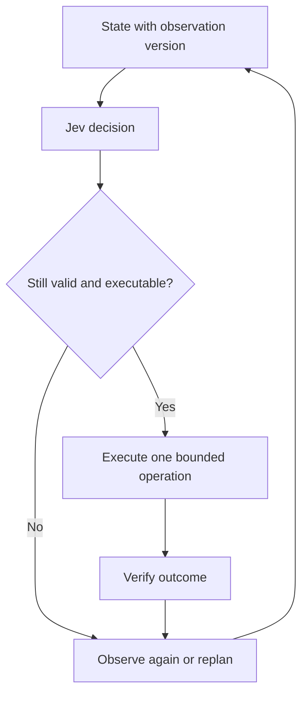

# Agent applications: evaluate the full loop

[Home](../README.md) · [中文](agents_zh.md)

Software agents can use Jev for action selection, context management, and continuous decisions, while executors handle control mappings, constraints, and result checks. This guide organizes representative systems around those roles; see the [survey](report.md#agents) for a unified systems view.

Software agents repeatedly transform observations into executable choices. A fast selector is useful when the state is adequate, the candidates cover the task, and execution is verified. The four cases below expose different bottlenecks.

## Responsibilities across four cases

| Case | Input to Jev | Decision | Program responsibility |
| --- | --- | --- | --- |
| [jev-ultrafast](https://github.com/browser-use/jev-ultrafast) | DOM text, numbered controls, task, history | Operation and matching target | Extract targets, validate nodes, perform action, verify completion |
| [typesafe-computer-use](https://github.com/awlevin/typesafe-computer-use) | Merged OCR/accessibility observations | Action and target ID | Perceive, map coordinates or activate references, observe changes |
| [fast-jev-compaction](https://github.com/tamaratran/fast-jev-compaction) | Task and tool interaction history | Retain call and retain result | Protect messages, preserve pairs, truncate or delete, rebuild context |
| [jev-trader](https://github.com/jarrodwatts/jev-trader) | Market state and allowed directions | Buy/sell direction | Enforce constraints, submit/cancel, process asynchronous feedback |

## Browser actions: selection depends on candidate coverage

In jev-ultrafast, one request can ask for the operation and potential targets. The executor uses only the target answer matching the selected operation. Free text is generated separately. Batching reduces serial requests, while DOM extraction, browser protocol efficiency, and completion checks remain major engineering contributors.

The [performance note](https://github.com/browser-use/jev-ultrafast/blob/main/docs/performance.md) describes a flight-search example and six alternating runs: each configuration passes 3/3, while median time changes from 9.450 to 7.092 seconds and browser protocol calls from 1,092 to 101. Timing starts after the first observation. This is evidence for that engineering change on that task, not a cross-site model benchmark.

A node omitted by frame traversal or Shadow DOM handling is absent from Jev's candidate set. A previously valid target can become stale after a page transition. The executor should associate candidates with an observation version and revalidate before acting.

## Desktop actions: perception and decision have different costs

The desktop project merges OCR and accessibility information into numbered targets. Prefer an actionable accessibility reference when available; otherwise the program transforms a bounding box into a click coordinate. That coordinate computation is not a learned Jev output.

The author's single-example comparison reports approximately 1.5 seconds for a full Jev/OCR step and 5.5 seconds for a screenshot-model step. The perception paths differ, so model-only latency cannot isolate overall system gains. Read the [step description](https://github.com/awlevin/typesafe-computer-use/blob/main/docs/how-a-step-works.md) and measure perception, requests, execution, and verification separately.

The same comparison separates model time from an approximate non-model remainder. The original example reports Jev calls of 0.13–0.38 seconds versus 5.2 seconds for the comparator. Subtracting from the approximate full-step values yields about 1.1–1.4 seconds versus 0.3 seconds outside the model. These are not separately measured OCR, clicking, or waiting times, and the two pipelines account for visual understanding in different places. See the [report](report.md#agents) for the full table.

## Context retention: deletion is a downstream decision

The compaction project asks whether to retain a tool call and its complete result. Its reviewed implementation keeps the full pair when the result is retained, truncates a result when only the call is retained, and otherwise removes the pair. Protected messages and pair structure are enforced by code ([implementation](https://github.com/tamaratran/fast-jev-compaction/blob/main/src/compact.ts)).

Token reduction alone is not enough. Evaluate loss of critical paths, constraints, unresolved errors, and later task success. Concept animations and mock demos do not measure those effects. Strong baselines include recency truncation and conventional summarization with the same context budget.

## Continuous decisions: a valid answer can arrive too late

In the reviewed jev-trader configuration, the public deployment and demo are dry-run/mock. The approximately 300 ms block interval is not Jev latency; mock-loop timing is not an online model measurement. The selected direction is buy/sell, while a displayed hold state can come from scheduling logic.

This case illustrates a general systems question: what happens if the environment changes before a model response arrives? Record observation age, rejected stale actions, skipped updates, and missed deadlines. Do not infer trading profitability from a loop demonstration.

## A reusable architecture

A generator can provide open-ended content or a new plan; Jev can make bounded choices; code handles identities, numeric transformations, execution conditions, and verification. This division is a design option, not a claim that every task benefits from all three components.

## What to test next

**Evidence selection:** freeze retrieved candidates, compare rules/LLM/Jev, and separately label relevance and whether a source supports a claim. Measure critical-evidence recall, false support, downstream answer quality, and total cost.

**Model routing:** compare always using a strong model, fixed rules, a small structured model, and Jev with a calibrated fallback. Hold tools and task splits fixed. Evaluate task completion and cost at matched coverage or risk.

[Evaluation guide](evaluation.md) · [Research roadmap](roadmap.md)
