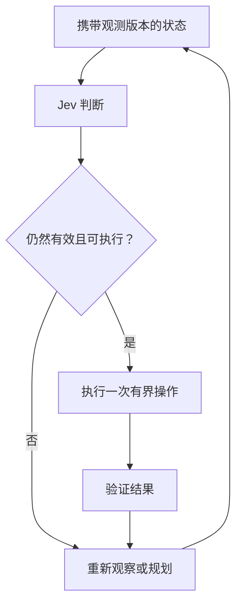

# Agent 应用：评价完整闭环

[首页](../README_zh.md) · [English](agents.md)

软件 Agent 可将动作选择、上下文管理和连续决策交给 Jev，再由执行器处理控件映射、约束和结果检查。下面按这三类职责介绍代表系统；跨领域的统一分析见[技术综述](report_zh.md#agents)。

软件 Agent 持续把观察转化为可执行选择。当状态足够、候选覆盖任务、执行结果得到验证时，快速选择器才可能改善系统。下面四个案例分别暴露了不同的瓶颈。

## 四个案例的职责划分

| 案例 | Jev 输入 | 判断 | 程序职责 |
| --- | --- | --- | --- |
| [jev-ultrafast](https://github.com/browser-use/jev-ultrafast) | DOM 文本、编号控件、任务与历史 | 操作及对应目标 | 提取目标、校验节点、执行动作、验证完成 |
| [typesafe-computer-use](https://github.com/awlevin/typesafe-computer-use) | OCR 与辅助功能合并后的状态 | 动作和目标 ID | 感知、坐标映射或控件激活、观察变化 |
| [fast-jev-compaction](https://github.com/tamaratran/fast-jev-compaction) | 任务与工具交互历史 | 是否保留调用及完整结果 | 保护消息、维持配对、截短删除、重建上下文 |
| [jev-trader](https://github.com/jarrodwatts/jev-trader) | 市场状态与允许方向 | buy / sell | 执行约束、提交撤单、处理异步反馈 |

## 浏览器操作：选择依赖候选覆盖

jev-ultrafast 可以在一次请求中询问操作和各类目标，执行器只使用与所选操作匹配的目标答案，自由文本另行生成。批量提问减少串行往返，DOM 提取、浏览器协议效率和完成检查也贡献了系统性能。

[性能记录](https://github.com/browser-use/jev-ultrafast/blob/main/docs/performance.md)描述了一个航班搜索例子和六次交替测试：两种配置各通过 3/3，中位耗时从 9.450 秒变为 7.092 秒，浏览器协议调用从 1,092 次变为 101 次，计时从第一次观察之后开始。这支持该任务上的工程优化，不是跨网站模型基准。

frame 遍历或 Shadow DOM 处理遗漏的节点不会进入 Jev 候选集合；页面变化也可能使原目标过期。候选应关联观测版本，执行前重新校验。

## 桌面操作：感知与判断的成本不同

桌面项目将 OCR 与辅助功能信息合并为编号目标。有可执行引用时优先激活控件，否则由程序将边界框转换为点击坐标。坐标换算不属于 Jev 学到的输出。

作者的单样例对照报告：Jev/OCR 完整单步约 1.5 秒，截图模型单步约 5.5 秒。两条感知链路不同，单模型延迟无法隔离完整收益。应结合[单步流程](https://github.com/awlevin/typesafe-computer-use/blob/main/docs/how-a-step-works.md)，分别测量感知、请求、执行与验证。

同一对照还可区分模型与模型外耗时。原始单样例中，Jev 模型调用为 0.13–0.38 秒，对照为 5.2 秒。用完整单步近似相减，模型外合计约为 1.1–1.4 秒与 0.3 秒；这不是 OCR、点击或等待的独立计时，不能据此确定各环节的因果贡献。两条路径把视觉理解计入不同位置。完整表格与解释见[技术综述](report_zh.md#agents)。

## 上下文保留：删除影响后续任务

压缩项目分别判断是否保留工具调用与完整结果。所审阅实现中，保留结果时保留完整配对；只保留调用时截短结果；两者都不保留时成对删除。消息保护与配对结构由程序维护（[实现](https://github.com/tamaratran/fast-jev-compaction/blob/main/src/compact.ts)）。

仅看 token 减少不够，还应测量关键路径、约束、未解决错误的误删，以及后续任务完成率。概念动画和模拟演示无法测量这些效果。合理基线包括相同上下文预算下的近期截断与常规摘要。

## 持续决策：正确格式的答案也可能迟到

所审阅 jev-trader 的公开部署与演示为 dry-run/mock。约 300 ms 是区块间隔，不是 Jev 请求延迟；mock 循环时间也不是在线模型实测。模型选择 buy/sell，界面显示的 hold 可能来自调度逻辑。

它揭示了通用问题：响应到达前环境已经变化，该如何处理？应记录观测年龄、因过期而拒绝的动作、跳过的更新与错过的时限。循环演示不能证明交易收益。

## 可以复用的架构

生成模型提供开放内容或新计划，Jev 作有限选择，程序负责身份对应、数值换算、执行条件与结果验证。这是一种可选分工，并非所有任务都需要三个组件。

## 后续实验

**证据筛选：** 固定检索候选，比较规则、LLM 与 Jev，分别标注主题相关性和是否支持结论，测量关键证据召回、错误支持、下游回答质量与总费用。

**模型路由：** 比较始终调用强模型、固定规则、小型结构化模型、带验证阈值与回退的 Jev。固定工具与数据划分，在匹配覆盖率或风险时比较任务完成和费用。

[评测导读](evaluation_zh.md) · [研究路线](roadmap_zh.md)
