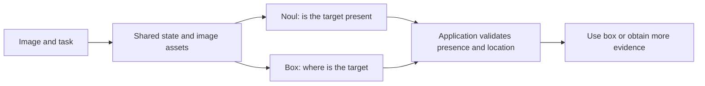

# Multimodal Jev: image decisions and Box localization

[Home](../README.md) · [Foundations](foundations.md) · [中文](multimodal_zh.md)

Images can appear in Jev’s shared state, questions, and candidates; Box extends the interface to target localization. This guide follows the official [Images](https://docs.typesafe.ai/go/images) and [Box](https://docs.typesafe.ai/go/box) documentation and examines candidate design, insufficient evidence, and visual evaluation.

## Versions and input forms

| Capability | Jev 1.13 | Jev 1.14 | Requirement |
| --- | --- | --- | --- |
| Images with Choice / Score / Noul | Supported | Supported | Enable images for the request |
| Box: target bounding rectangle | Not supported | Supported | Include an image and enable images |

TypeSafe labels images and Box **Dreamer-ready (experimental)**. Formats, limits, and accuracy may change. Send `TypeSafe-Danger-Zone-Images: true`. Whether an application uses images depends on its input design.

Images can appear in `state`, a question's `instructions`, or its `criteria`, including picture-defined answer options. List each image in the top-level `assets` map and use a unique reference string in the request. When multiple questions use an image, put it in shared state and refer to the state field from each question.

The API supports multipart files or JSON `data_base64`. Use still PNG/JPEG images, 280–1568 pixels on each side, up to 16 MiB per image and 32 MiB for the request body. Separate 32 MiB limits apply to all processed images and the expanded request. Out-of-range images are rejected rather than automatically resized. Prepare orientation, dimensions, and encoding before sending; record changes from the original. Repeated insertion of an image reference increases expanded size. See [Images](https://docs.typesafe.ai/go/images) for the complete rules.

The [multimodal request](../examples/multimodal_request.json) asks four question types about one image. [Example instructions](../examples/README.md) describe the corresponding multipart file. No image or measured response is bundled with that illustrative request.

## What Box returns

Box takes `type: "box"` and `instructions`, without `criteria`. Each answer returns one box and a `confidence`:

```text
box = {left, top, right, bottom}
pixel box = (left × W, top × H, right × W, bottom × H)
```

Edges are normalized to 0–1 from the image's top-left corner. Each question locates one target. Multiple similar objects require an unambiguous description, image regions, or separate questions. The Box documentation does not define its confidence with the Choice formula, and confidence is not IoU.

**Box returns a rectangle even when the target is absent.** The documentation recommends a Noul presence question in the same request, followed by application-side acceptance or rejection. Questions are independent: Noul does not cancel Box inside the model. Validate the presence threshold; occlusion or blur can also reject a real target.



## Multimodal judgments and candidate design

The following transcribed demonstrations are dated **2026-10-27**, requesting `jev-latest` and returning `jev-1.14.0`. See the [JSON records](../data/demo-records.json) for inputs, candidates, and responses. These small examples illustrate candidate design; they have no independent ground-truth annotation or complete HTTP logs and do not establish benchmark performance.

### The General: four types and a missing candidate

The input still is 480×368. With train, car, boat, and airplane offered, Choice selects train with `p=0.95`, confidence `0.93`. Replacing train with bicycle keeps four options but produces car with `p=0.96`, confidence `0.95`. No correct answer remains in that second set; high confidence cannot repair the missing candidate.

The same request records a person-count Score of `1.09` over levels 0/1/2/3/4+, a horse-presence Noul of `0.04`, and a person Box of `{left: 0.28, top: 0.05, right: 0.77, bottom: 0.86}` with confidence `0.87`. Score is an expected level, not an integer count. No independently annotated reference box is supplied, so this example establishes no IoU result.

Image source: [Wikimedia Commons, The General](https://commons.wikimedia.org/wiki/File:The_General,_front.jpg), marked public domain by the source.

### The Kid: sufficient evidence and answer choices

The input is a 510×311 PNG, with ten questions in one request. The model received only the original image, without additional enlarged crops. Here `p` is the selected option's probability and `C` is the recorded API confidence.

| Question | Correct or abstention option available | After removing that option | Interpretation |
| --- | --- | --- | --- |
| Small objects on the shelf | Vessels `p=1.00, C=1.00` | Flower pots `p=0.77, C=0.69` | Missing candidates force a choice among wrong alternatives |
| Text on the doorway notice | Unreadable `p=0.91, C=0.88` | Closed today `p=0.53, C=0.37` | A specific text output does not establish legibility |
| Color of the child's balloon | No balloon `p=0.95, C=0.93` | White `p=0.67, C=0.56` | Allow rejection of false premises |
| Biological father and son | Cannot determine `p=0.94, C=0.91` | No `p=0.94, C=0.88` | Kinship is not established by the frame; option count also changes from 3 to 2 |
| Where the child walks next | Cannot determine `p=0.28, C=0.04` | Right `p=0.32, C=0.09` | Both distributions are diffuse; no future clip validates the outcome |

Image source: [Wikimedia Commons, The Kid](https://commons.wikimedia.org/wiki/File:Still_from_Charles_Chaplin_-_The_Kid_-_1921_-_Charles_Chaplin_Productions_-_EYE_FOT2415.JPG), marked public domain by the source. The Chinese descriptions translate English requests; they are not measurements of Chinese prompts.

### Six-question comparison with Visual Jev

The [Visual Jev author's demo](https://github.com/guanxuyu-sv/Visual-Jev/blob/main/code/examples/bottle_questions.json) and a recorded official Jev 1.14 call use the same original 500×302 JPEG and six English questions/options. All six top choices agree, while distributions differ. For example, green bottle probability is `0.993` in the Visual Jev display and `0.89` in the official Jev record; the latter's API confidence is `0.85`.

More concentrated probabilities or agreement on one image do not establish better accuracy or calibration. The third question's `incorrect_question` description already says the image shows a dog rather than a person, so it is not independent evidence of visual premise correction. The Visual Jev confidence estimates in this comparison were calculated from displayed probabilities, not native response fields. See [community implementations](community-models.md) for the systems' differences.

## Community COCO evaluation

[Rohit Ghumare's report](https://rohitghumare.com/blog/typesafe-870m-can-jev-see/) selects 48 COCO 2017 validation images across six target categories and repeats each model twice. These are **author-reported** results, not repository reruns. Repeated answer counts are not independent image counts.

| Metric | Jev 1.13 | Jev 1.14 |
| --- | --- | --- |
| Noul accuracy at 0.5, 768 answers/model | 98.4% | 99.1% |
| Noul Brier score, lower is better | 0.0105 | 0.0088 |
| Choice with word options, 96 answers/model | 97.9% | 97.9% |
| Choice with picture options, 96 answers/model | 96.9% | 95.8% |
| Score rounded to four object-area levels, 96 answers/model | 60.4% | 80.2% |
| Box mean / median IoU, 96 boxes | Unsupported | 0.85 / 0.90 |
| Absent-target boxes rejected by Noul | Unsupported | 96 / 96 |

This small selected set includes incomplete labels, multiple instances, and semantic ambiguities. The Noul gate rejected every absent target but also one real target per run, a blurred pizza slice. Report both false acceptance and false rejection; 96/96 does not imply lossless rejection. Brier measures overall probability error, so one score does not establish universal calibration.

## Further evaluation

Hold images, option count, and English instructions fixed while comparing textual state, original images, crops, and combined inputs. Test missing candidates, false premises, outside-image facts, and temporal inference separately. Localization needs reference boxes, IoU, false rejection from presence gating, and complete task outcomes. Original image, resize, compression, crop coordinates, endpoint, and returned model version are all experimental configuration.

[Evaluation](evaluation.md) · [Research roadmap](roadmap.md) · [Data notes](../data/README.md)
