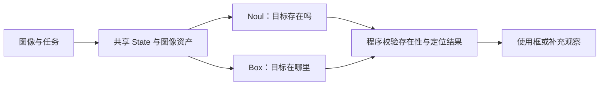

# 多模态 Jev：图像判断与 Box 定位

[首页](../README_zh.md) · [模型基础](foundations_zh.md) · [English](multimodal.md)

图像可以进入 Jev 的共享状态、题干和候选；Box 则将判断扩展到目标定位。本节结合 [Images](https://docs.typesafe.ai/go/images) 与 [Box](https://docs.typesafe.ai/go/box) 官方文档，讨论接口使用、候选设计、证据不足和视觉评测。

## 版本与输入形式

| 能力 | Jev 1.13 | Jev 1.14 | 接入条件 |
| --- | --- | --- | --- |
| 图像 + Choice / Score / Noul | 支持 | 支持 | 请求加入图像开关 |
| Box：返回目标边界框 | 不支持 | 支持 | 请求包含图片，加入图像开关 |

官方将图像与 Box 标为 **Dreamer-ready（实验能力）**，格式、限制和准确率可能随版本改变。必须发送 `TypeSafe-Danger-Zone-Images: true`。具体项目是否使用图像，取决于其输入设计。

图像可以放在 `state`、问题的 `instructions` 或候选的 `criteria` 中，因此不仅能“看图选文字”，也能用参考图片定义选项。顶层 `assets` 列出图像，通过唯一引用字符串在请求中使用。多个问题使用同一张图时，将图像放在共享状态中，各题通过字段路径引用。

官方支持 multipart 文件上传，或 JSON 中的 `data_base64`。使用 PNG/JPEG 静态图像，每边 280–1568 像素、单图不超过 16 MiB，请求体不超过 32 MiB；官方还对处理后的全部图像和引用展开后的请求分别设有 32 MiB 限制。API 不会自动把越界图像缩放到合规尺寸。发送前处理旋转、尺寸和编码，记录原图与实际输入的差异。重复插入同一图像引用仍会增加展开体积。完整约束见 [Images](https://docs.typesafe.ai/go/images)。

[多模态示意请求](../examples/multimodal_request.json)在一张图上同时提出四类问题；[示例说明](../examples/README.md)给出 multipart 的文件对应方法。示例没有附带图片或模型输出。

## Box 返回什么

Box 仅需 `type: "box"` 和 `instructions`，没有 `criteria`。每题返回一个框及 `confidence`：

```text
box = {left, top, right, bottom}
像素框 = (left × W, top × H, right × W, bottom × H)
```

四个边界为 0–1 的归一化坐标，以图像左上角为原点。一个问题定位一个目标；多个同类目标需要明确描述、分区，或用多个问题处理。Box confidence 没有在此文档中定义为 Choice 的概率公式，也不能直接当作 IoU。

**目标不存在时，Box 仍会返回框。** 官方建议同批增加 Noul 存在性问题，由程序根据结果决定是否采用该框。两个问题独立求值，Noul 并不会在模型内部取消 Box。存在性阈值需要验证；遮挡或模糊也可能使真实目标被拒绝。



## 多模态判断与候选设计

以下为 **2026-10-27** 的多模态演示记录转录，请求 `jev-latest`，返回 `jev-1.14.0`。输入、候选与响应字段见 [JSON 记录](../data/demo-records.json)。这些小样本用于分析候选设计；没有独立真值标注或可核验的完整 HTTP 日志，不能作为基准成绩。

### 《将军号》：四种接口与缺失候选

电影剧照输入为 480×368。车辆 Choice 给出火车、汽车、轮船、飞机时，返回火车 `p=0.95`、confidence `0.93`。删去火车并补入自行车，仍保留四个候选时，返回汽车 `p=0.96`、confidence `0.95`。后者没有可正确选择的答案，高置信度无法修复缺失候选。

同一请求还记录：人数 Score 为 `1.09`（等级 0/1/2/3/4+），有马的 Noul 为 `0.04`，人物 Box 为 `{left: 0.28, top: 0.05, right: 0.77, bottom: 0.86}`、confidence `0.87`。Score 是等级期望，不是整数计数；该 Box 没有独立真值框，不能据此给出 IoU。

图像来源：[Wikimedia Commons，《将军号》](https://commons.wikimedia.org/wiki/File:The_General,_front.jpg)，来源页标注为公有领域。

### 《寻子遇仙记》：证据是否足够

输入为 510×311 PNG，十题同请求提交。模型仅接收原始图像，未接收局部放大图。表中 `p` 为所选候选概率，`C` 为响应中的 confidence，均保留记录值。

| 问题 | 提供正确或可暂缓候选 | 删除该候选后的结果 | 可以说明什么 |
| --- | --- | --- | --- |
| 架子上的小物体 | 器皿 `p=1.00, C=1.00` | 花盆 `p=0.77, C=0.69` | 缺少正确选项会迫使模型在错误选项中选择 |
| 门边纸条的文字 | 看不清 `p=0.91, C=0.88` | 今日休息 `p=0.53, C=0.37` | 输出具体文字不等于文字确实可辨认 |
| 儿童手中气球的颜色 | 未见气球 `p=0.95, C=0.93` | 白色 `p=0.67, C=0.56` | 需要允许指出错误前提 |
| 是否亲生父子 | 无法确定 `p=0.94, C=0.91` | 否 `p=0.94, C=0.88` | 亲缘关系不能仅靠单帧确定；候选数也从 3 变为 2 |
| 儿童下一步往哪里走 | 单图无法确定 `p=0.28, C=0.04` | 向右 `p=0.32, C=0.09` | 两组均分散；未提供未来片段，不能验证实际走向 |

图像来源：[Wikimedia Commons，《寻子遇仙记》](https://commons.wikimedia.org/wiki/File:Still_from_Charles_Chaplin_-_The_Kid_-_1921_-_Charles_Chaplin_Productions_-_EYE_FOT2415.JPG)，来源页标注为公有领域。中文为英文请求的说明，不是中文提示词复测结果。

### 与 Visual Jev 的六题演示

[Visual Jev 作者演示](https://github.com/guanxuyu-sv/Visual-Jev/blob/main/code/examples/bottle_questions.json)与官方 Jev 1.14 的一组调用使用同一原始 500×302 JPEG，以及相同的六道英文问题与候选。两者六个最高概率选项一致，分布不同。例如绿色瓶子在 Visual Jev 展示中为 `0.993`，官方 Jev 记录为 `0.89`，后者 API confidence 为 `0.85`。

不能由概率更集中或单图答案一致，判断哪个模型整体更好或更校准。第三题的 `incorrect_question` 候选描述已经提示“图中是狗而不是人”，不能作为独立视觉纠错证据。对照中的 Visual Jev 置信度是按展示概率换算的估计值，并非原生响应字段。两个系统的实现区别见[社区实现](community-models_zh.md)。

## 社区 COCO 评测

[Rohit Ghumare 的社区报告](https://rohitghumare.com/blog/typesafe-870m-can-jev-see/)选择 COCO 2017 验证集 48 张图、六类目标，各版本重复两次。下表为**作者报告**，不是本仓库重跑；重复答案数量不等于独立图像数量。

| 指标 | Jev 1.13 | Jev 1.14 |
| --- | --- | --- |
| Noul 正确率，阈值 0.5，768 个答案/版本 | 98.4% | 99.1% |
| Noul Brier 分数，越低越好 | 0.0105 | 0.0088 |
| Choice 文字候选，96 个答案/版本 | 97.9% | 97.9% |
| Choice 图片候选，96 个答案/版本 | 96.9% | 95.8% |
| Score 四档目标占比，四舍五入到等级，96 个答案/版本 | 60.4% | 80.2% |
| Box 平均 / 中位 IoU，96 个框 | 不支持 | 0.85 / 0.90 |
| Noul 拦截不存在目标的 Box | 不支持 | 96 / 96 |

这是一组经过筛选的小样本，存在漏标、多实例与问题语义边界。Noul 门控虽拦住所有不存在目标，也在每轮误拒绝一个真实目标（模糊披萨）。应同时报告误接纳与误拒绝，不能把 96/96 写成无损拒绝能力。Brier 综合反映概率误差，不能仅凭单个分数证明普遍校准。

## 后续验证

固定图像、候选数与英文题干，对比文本状态、原图、裁剪图和图文联合输入；分别测量候选缺失、错误前提、图外信息及时间推断。定位任务需记录真值框、IoU、存在性门控的误拒绝率及完整任务结果。原图、缩放、压缩、裁剪坐标、端点和实际模型版本都属于实验配置。

[评测协议](evaluation_zh.md) · [研究路线](roadmap_zh.md) · [数据说明](../data/README.md)
