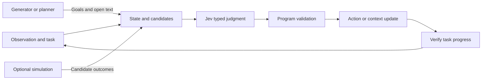

# Jev survey: structured decisions, agents, and embodied intelligence

**Authors:** [Jiahao Chen](https://github.com/ajackchan) · [Acceleter](https://github.com/Acceleter) · [Lizhou Liang](https://github.com/llz1515) · [KagaKouk0](https://github.com/KagaKouk0)

[Home](../README.md) · [简体中文](report_zh.md)

## Abstract

Jev expresses model calls as structured judgments over a supplied state: candidate selection, ordinal scoring, proposition probabilities, and image localization. Such interfaces can serve recurring decisions in action selection, context retention, and execution checks. This survey covers the interface and community implementations, software-agent applications, and navigation, simulation-assisted selection, and local robot control.

Across these settings, the model is one component of a larger system. Perception determines the available evidence; candidate construction and control determine the available behavior; fresh observations establish whether an action actually helped. Faster model calls can reduce decision time, while overall gains depend on perception, execution, feedback, and recovery. This report organizes the mechanisms and results around those dependencies.

## Contents

- [1. A shared systems view](#system)
- [2. Foundations and community implementations](#foundations)
- [3. Agents: actions, context, and continuous decisions](#agents)
- [4. Embodied AI: navigation, simulation, and local actions](#embodied)
- [5. Closed-loop VLA and world models](#loops)
- [6. Evaluation and research questions](#evaluation)
- [7. Conclusions and reading routes](#conclusion)

## 1. A shared systems view

| Layer | Responsibility | Representative mechanisms |
| --- | --- | --- |
| Perception and state | Expose evidence needed for the current decision | DOM, OCR/accessibility, waypoint descriptions, RGB-D, proprioception |
| Generation and planning | Supply open text, task decomposition, or local goals | Browser form text, visual robot planning |
| Jev judgment | Select, score, or locate within the expressed problem | Control IDs, retained history, navigation direction, local motion |
| Code and control | Preserve identities, enforce constraints, execute commands | Node checks, paired message deletion, velocity control, inverse kinematics |
| Verification | Establish actual task progress | Flight-result checks, arrival, door motion, independent success predicates |

This is an analytical division of labor. Not every project needs every layer. Context compaction changes internal history, but its quality still depends on what happens in subsequent tasks.

## 2. Foundations and community implementations

### 2.1 State and typed outputs

Jev is a TypeSafe hosted API. State supplies shared evidence and Questions define the judgments. Questions in one request are evaluated independently. Dependencies between answers must be handled explicitly by the application.

| Primitive | Meaning | Examples |
| --- | --- | --- |
| Choice | A selection and distribution over supplied candidates | Department, control, action |
| Score | Ordered-level probabilities and the expected level index | Frustration, task progress |
| Noul | Probability that a proposition is true | Urgency, retaining a tool result |
| Box | One normalized target box and confidence | Locating a person or object |

The [official image documentation](https://docs.typesafe.ai/go/images) states that both Jev 1.13 and 1.14 accept images; Box requires 1.14. Images and Box are experimental and require explicit enablement. Individual applications may still choose OCR or structured input.

### 2.2 Candidates and confidence

[Multimodal examples](multimodal.md) illustrate how candidate design changes decisions. In the example from *The General*, Jev selects the train when it is available. Removing that answer yields a car selection with probability `0.96` and API confidence `0.95`. Other examples vary whether “unreadable,” “incorrect premise,” or “cannot determine” is an available answer.

These small recorded examples illustrate interface risks; they do not establish their population frequency. Concentrated probabilities cannot repair a missing correct candidate. Image details, family relationships, and future motion also require different kinds of evidence.

Choice/Score confidence is a distribution statistic, while Noul directly returns a proposition probability. Box can return a rectangle for an absent object, so presence and localization need separate evaluation. See [foundations](foundations.md) and [multimodal Jev](multimodal.md).

### 2.3 Two community implementation routes

| Route | Project | Training and execution |
| --- | --- | --- |
| Read an existing language-model head | [OpenJev](https://github.com/razorback16/openjev) | Existing diffusion-model weights; read and normalize candidate-token scores at answer slots |
| Read an existing language-model head | [Visual Jev](https://github.com/guanxuyu-sv/Visual-Jev) | Qwen3-VL with answer-SFT LoRA; share the visual prefix and batch independent questions |
| Add decision modules | [NanoJev](https://github.com/TianyuCodings/NanoJev) | Jointly train a small Qwen backbone and a decision head for selected games |
| Add decision modules | [CLM](https://github.com/Contrastive-LM/CLM) | Freeze the text backbone; contrastively train state/action projections and reuse candidate encodings |

These independent projects do not reveal official Jev's complete architecture. Training, computation reuse, and image support are separate dimensions.

Visual Jev reports average accuracy increasing from 70.6% to 76.1% across four tasks, and amortized time decreasing from 50.7 to 5.7 ms/question for 32 questions about one image. The accuracy result concerns training; the timing result concerns batching and prefix reuse. It is not single-request API latency. CLM's reported results also show that lower latency can accompany lower success. See [community implementations](community-models.md) for settings and limitations.

### 2.4 What foundation benchmarks establish

Available evaluations include both vendor workflow tests and an [independent 37-dataset evaluation](https://arxiv.org/abs/2609.37647). Agreement with a reference consensus in a vendor test is different from general accuracy. Under its specified versions and scoring setup, the independent paper reports 27 wins, nine losses, and one tie against Qwen3.8-27B, with non-overlapping bootstrap intervals for 11 wins.

These results motivate studying the decision interface; they do not determine software-agent or robot task success.

## 3. Agents: actions, context, and continuous decisions

Agent decisions span **Action → Context → Continuous Decision**. A judgment can change an external environment, manage internal history, or operate under a deadline.

### 3.1 Browser and desktop actions

| Project | State | Jev decision | Execution and checking |
| --- | --- | --- | --- |
| [jev-ultrafast](https://github.com/browser-use/jev-ultrafast) | Page text, numbered DOM controls, goal, history | Operation and potential targets | Use the matching target, check node validity, verify flight results |
| [typesafe-computer-use](https://github.com/awlevin/typesafe-computer-use) | Merged OCR/accessibility; code adds facts such as dates | Action and target IDs | Recover a control reference or coordinate, act, observe again |

The browser implementation can ask for an operation, click target, and text target together. An illustrative `CLICK / click[7] / type[3]` response leads to clicking `[7]` only. These IDs explain the mechanism; they are not a recorded trajectory. Batching reduces serial network round trips, while free text still comes from a helper model.

In the author's [six alternating runs](https://github.com/browser-use/jev-ultrafast/blob/main/docs/performance.md), both configurations pass 3/3. Median task time changes from 9.450 to 7.092 seconds, and browser protocol calls from 1,092 to 101. Both arms use Jev: this measures an engineering change on one task, not Jev versus another model. Initial setup/navigation and fresh independent post-run verification are outside the reported timing.

The desktop comparison uses different perception paths:

| Single-example measurement | Jev + OCR | Opus 5 + screenshot |
| --- | --- | --- |
| Model call | 0.13–0.38 s | 5.2 s |
| Full step | About 1.5 s | About 5.5 s |
| Non-model remainder, approximate subtraction | About 1.1–1.4 s | About 0.3 s |
| Cost per decision | About $0.0002 | About $0.032 |

Source: [author README](https://github.com/awlevin/typesafe-computer-use#why-a-classifier). The remainder is not separately measured OCR, execution, or waiting time. Screenshot understanding occurs inside the comparison model call, whereas Jev's OCR and factual preprocessing occur outside it. The approximately 3.7× full-step difference does not isolate a model effect or establish whole-task speedup.

### 3.2 Retaining context

[fast-jev-compaction](https://github.com/tamaratran/fast-jev-compaction) asks two Noul questions about a tool call and its result. Code then retains the pair, retains the call with a truncated result, or deletes the pair. Ordinary conversation text and protected messages follow program rules.

Errors can emerge later: losing a needed path or unresolved error can impair the next task. Evaluate retained critical facts and downstream completion, not just fewer tokens. The cited concept animation is not measured compression performance.

### 3.3 Keeping decisions timely

[jev-trader](https://github.com/jarrodwatts/jev-trader) chooses `buy / sell` from changing market state. Code determines positions, prices, sizes, and asynchronous execution. The approximately 300 ms figure is a block interval; displayed `hold / late` states include scheduler behavior.

The reviewed public demonstration is dry-run/mock and does not establish returns. Its general systems question is whether the original observation remains valid when a response arrives—a concern shared by browser transitions, changing desktop controls, and moving robots.

## 4. Embodied AI: navigation, simulation, and local actions

Embodied applications can be understood through spatial reasoning, action simulation, and local control. NavJev and Nav Arena study navigation, jev-libero compares candidate consequences, and EmbodiedJev and RoboJEV connect action selection to execution feedback.

### 4.1 Navigation

[NavJev](https://arxiv.org/abs/2609.34969) converts panoramic observations into action-centered waypoint descriptions, retains discriminative semantics and history, and selects a waypoint or stop. The cited 100-task comparison reports Jev 27%, GPT-4o 14%, and Qwen3.8-Max 25%. The visual front end, representation, candidates, and non-reasoning baselines are part of that setting.

[Can Jev Nav? / Nav Arena](https://research.dimensional.org/system-one-navigation/) asks about movement, turning, stopping, completion, and the target; code converts these answers into velocity commands. The authors report the following short-range subset (under 10 meters):

| System | Arrivals / 45 tasks under 10 m | Cost per run |
| --- | --- | --- |
| Jev | 32 | $0.055 |
| Fable 5.1 | 31 | $0.685 |
| Astra | 40 | $0.877 |

This is an author-reported system comparison, not an isolated model comparison or the entire navigation evaluation. The physical-robot video demonstrates a working sequence.

### 4.2 Simulating candidate actions

[jev-libero](https://github.com/Dimweaker/jev-libero) uses a known physics simulator to preview 27 primitive actions for up to 0.4 simulation seconds each. Code measures contact, distance, and progress and filters candidates. Jev selects intent, contact/motion category, and a concrete action; execution of a short segment is followed by fresh observation.

The simulator predicts, code measures and filters, and Jev selects. Selecting after all previews cannot save computation already spent on them. The project shows microwave-closing and soup-can placement examples, not a full LIBERO benchmark.

### 4.3 Local behavior and feedback

[EmbodiedJev](https://github.com/FBddcz/embodied-jev) shares a GPT-6 visual planner across two systems and compares GPT-6 versus Jev for local direction and gripper selection. The system uses two RGB-D cameras and proprioceptive feedback.

| Development task | GPT-6 only | GPT-6 + Jev |
| --- | --- | --- |
| Close drawer | Completed; about 610 s; estimated $2.15 | Completed; about 320 s; estimated $0.39 |
| Close microwave | Completed | Not completed within 1,200 s |

Source: the [author's development record](https://github.com/FBddcz/embodied-jev/blob/main/docs/results/libero-vision/RESULTS.md). Drawer time falls by about 48% in that pair, while the microwave failure remains part of the result. The public record includes reruns and extra costs; showcased recordings are not first-attempt success rates or a stable performance estimate.

[RoboJEV](https://github.com/lykycy123/RoboJEV) first selects an intent and then XYZ directions and gripper state, which code converts into small motions. Across five simulated tasks, the authors report 43/50 completions for Jev and 48/50 for rules; gate transport is 5/10 versus 8/10. The rule baseline is better in this setting.

These cases make outcome feedback essential: end-effector movement does not establish object movement, locally correct directions do not establish a feasible high-level goal, and one successful recording does not describe the failure distribution.

## 5. Closed-loop VLA and world models

The execution, prediction, and learning framework in [Awesome Closed-Loop VLA](https://github.com/ZJU-OmniAI/Awesome-Closed-Loop-VLA) helps locate the evidence:

| Loop | Mechanism in this report | Supported scope |
| --- | --- | --- |
| Execution | Observe again, select the next action, validate the outcome | Browser, navigation, and local-control examples; quality depends on observing actual progress |
| Prediction | Compare simulated candidate outcomes before acting | jev-libero uses a known simulator; no verified joint gain with a learned world model |
| Learning | Update a model, policy, or evaluator from interaction | These systems have not demonstrated continual learning during deployment |

[Awesome World Model](https://github.com/ZJU-OmniAI/Awesome-World-Model) supplies definitions and a methods index. A learned predictor introduces additional questions about prediction error, horizon, representation, and ranking. Results from rollback in a known simulator do not establish learned-world-model reliability.

Offline community-model training is also distinct from learning during robot deployment. Repeated judgment calls change current behavior; parameter updates and accumulated experience require separate mechanisms and evidence.

## 6. Evaluation and research questions

| Level | Measurements | Record or control |
| --- | --- | --- |
| Judgment | Accuracy, probability error, coverage, false acceptance/rejection | Inputs, candidates, question wording, version, thresholds |
| System step | Perception, request, execution, waiting, observation age | Perception paths, timing boundaries, concurrency, network |
| Full task | Success, total time and cost, recovery | Every attempt, failures, retries, budgets, independent success criteria |

The figures 5.7 ms/question, 0.13–0.38 s/model call, a 300 ms block interval, 0.4 simulation seconds, and 320 seconds/task measure different things. They do not belong in one latency ranking.

Four research questions follow from these systems:

1. **State and candidates:** compare text, images, and combined state with missing candidates, ambiguous targets, and false premises; test abstention choices and additional observation.
2. **Selection and generation:** compare rules, structured LLMs, Jev, and fallback combinations under fixed tools and budgets; set thresholds on separate validation data and count fallback costs.
3. **Physical progress:** compare end-effector-only feedback with direct object-progress feedback, separating feedback improvements from selector improvements.
4. **Prediction scheduling:** evaluate post-prediction ranking separately from pre-prediction gating. Skipping computation requires deciding before it runs and checking that an existing plan remains usable.

These are proposals, not completed experiments. See the [evaluation guide](evaluation.md) and [roadmap](roadmap.md).

## 7. Conclusions and reading routes

Jev is a useful subject for studying recurring, bounded model decisions inside larger systems. Published work demonstrates interfaces and application mechanisms, while also exposing missing candidates, perception overhead, stale state, contact failures, and stronger rule baselines. The research question is which tasks and divisions of labor produce measurable system benefits.

Continue with [foundations](foundations.md), [multimodal Jev](multimodal.md), [community implementations](community-models.md), [agents](agents.md), and [embodied AI](embodied.md). The [home page](../README.md) indexes all public resources.
