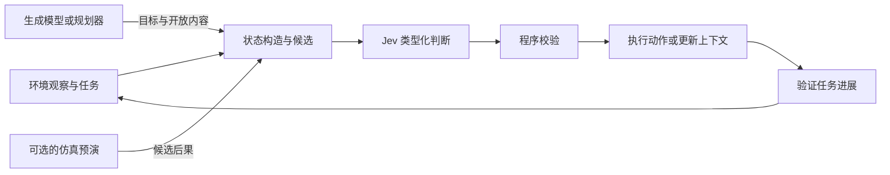

# Jev 技术综述：结构化判断、Agent 与具身智能

**作者：** [Jiahao Chen](https://github.com/ajackchan) · [Acceleter](https://github.com/Acceleter) · [Lizhou Liang](https://github.com/llz1515) · [KagaKouk0](https://github.com/KagaKouk0)

[中文首页](../README_zh.md) · [English](report.md)

## 摘要

Jev 将一部分模型调用组织为结构化判断：给定状态和问题，返回候选选择、等级评分、命题概率或图像定位。这种接口适合动作选择、信息保留和执行检查等反复出现的局部决策。本文讨论其接口及实现方式、软件 Agent 应用，以及在机器人导航、动作预演和局部控制中的作用。

这些案例共同说明，模型判断只是系统的一环。可见信息由感知与状态构造决定，可执行行为由候选和控制程序决定，成功与否还需要新的观察验证。更低的模型调用延迟可以缩短局部决策，但完整任务的收益取决于感知、执行、反馈和失败恢复。本文围绕这条依赖关系归纳技术路线、代表结果和后续研究问题。

## 目录

- [1. 统一视角：判断如何进入系统](#system)
- [2. 模型基础：接口、概率与社区实现](#foundations)
- [3. Agent：动作、上下文与连续决策](#agents)
- [4. 具身智能：导航、预演与行为选择](#embodied)
- [5. 与闭环 VLA、世界模型的联系](#loops)
- [6. 评测与研究方向](#evaluation)
- [7. 结论与延伸阅读](#conclusion)

## 1. 统一视角：判断如何进入系统

三个研究方向可以用同一条链路描述：

| 层次 | 负责什么 | 代表机制 |
| --- | --- | --- |
| 感知与状态 | 将可用信息整理为当前决策的依据 | DOM、OCR / Accessibility、路点描述、RGB-D、本体状态 |
| 生成与规划 | 提供自由文本、任务分解或局部目标 | 浏览器输入文字、视觉规划器给出机械臂目标 |
| Jev 判断 | 在已表达的问题与候选上选择、评分或定位 | 控件编号、历史保留、导航方向、机器人局部动作 |
| 程序与控制 | 保持对象对应，执行约束和控制命令 | 节点校验、成对删除工具消息、速度命令、逆运动学 |
| 结果验证 | 判断动作是否产生真实进展 | 航班结果核验、到达判断、门角度变化、独立成功判据 |

这是一种分析分工，并不要求每个项目都包含所有模块。上下文压缩甚至不执行外部动作，但仍需观察压缩是否影响后续任务。

## 2. 模型基础：接口、概率与社区实现

### 2.1 State 与四种输出

Jev 由 TypeSafe 通过托管 API 提供。State 承载共享信息，Questions 定义要判断的事项。同一请求中的多题共享状态并独立求值；某题依赖另一题的答案时，应由程序组织先后或联合候选。

| 类型 | 输出 | 典型用途 |
| --- | --- | --- |
| Choice | 给定候选上的选择与概率分布 | 部门分类、控件选择、动作选择 |
| Score | 有序等级概率与等级索引的期望 | 客户不满程度、任务进展 |
| Noul | 命题为真的概率 | 是否紧急、是否保留工具结果 |
| Box | 单目标归一化边界框及置信度 | 图像中的人物或物体定位 |

[官方图像文档](https://docs.typesafe.ai/go/images)明确：Jev 1.13 与 1.14 均接受图像，Box 需要 1.14，图像与 Box 属于需显式开启的实验能力。具体应用仍可能选择 OCR 或结构化状态。

### 2.2 候选设计与判断可靠性

[多模态示例](multimodal_zh.md)展示了候选集合对判断的影响。《将军号》画面中，候选包含“火车”时选择火车；删除正确选项后，模型以 `0.96` 的概率选择了汽车，API confidence 为 `0.95`。另一些例子表明，“看不清”“前提错误”“无法确定”等选项会改变输出。

这些记录说明了接口设计风险，但样本量不足以估计其普遍发生频率。对于视觉细节、亲缘关系、未来动作等问题，应先区分图像是否包含足够证据，再评价判断质量。概率在给定候选内集中，不保证候选本身正确或完备。

Choice / Score confidence 是分布的统计量，Noul 原生返回命题概率；不同接口的统计量不能直接混用。Box 在目标不存在时也可能返回框，应另行检验存在性与定位质量。详见[模型基础](foundations_zh.md)与[多模态导读](multimodal_zh.md)。

### 2.3 官方接口与社区模型

社区实现可按“选项分数从哪里来”分为两条路线：

| 路线 | 项目 | 训练与推理特征 |
| --- | --- | --- |
| 读取原有语言模型输出 | [OpenJev](https://github.com/razorback16/openjev) | 使用现成扩散模型权重，从答案槽读取候选 token 分数并归一化 |
| 读取原有语言模型输出 | [Visual Jev](https://github.com/guanxuyu-sv/Visual-Jev) | Qwen3-VL 加答案监督 LoRA；共享图像前缀，各题独立批处理 |
| 增加决策模块 | [NanoJev](https://github.com/TianyuCodings/NanoJev) | 小型 Qwen 底座与共享决策头共同训练，覆盖特定游戏 |
| 增加决策模块 | [CLM](https://github.com/Contrastive-LM/CLM) | 冻结文本底座，对比训练状态和动作投影头，候选编码可复用 |

这些独立项目不揭示官方 Jev 的完整内部实现。是否训练、是否共享计算、是否支持图像，分别影响不同能力。

Visual Jev 作者报告四任务平均准确率由 70.6% 升至 76.1%，同图 32 题的摊销耗时由 50.7 降至 5.7 ms/题。前者涉及训练，后者涉及批处理和前缀复用；5.7 ms/题不是单题 API 请求延迟。CLM 的作者结果也体现了延迟与成功率之间的取舍。详细设置见[社区实现](community-models_zh.md)。

### 2.4 基础能力证据

现有评测包括官方工作流自测和[独立的 37 数据集评估](https://arxiv.org/abs/2609.37647)。官方自测中的参考共识一致率，不等于通用任务准确率。独立论文在指定模型版本、输入与评分设置下报告 Jev 对 Qwen3.8-27B 有 27 项领先、9 项落后、1 项持平；其中 11 项领先的 bootstrap 区间不重叠。

这些结果支持进一步研究快速判断接口，但不能直接推导完整 Agent 或机器人任务的成功率。

## 3. Agent：动作、上下文与连续决策

软件 Agent 中的判断可分为 **Action → Context → Continuous Decision**：判断既可改变外部环境，也可管理内部历史，还必须适应持续变化的状态。

### 3.1 动作执行：浏览器与桌面

| 项目 | 状态构造 | Jev 输出 | 执行及验证 |
| --- | --- | --- | --- |
| [jev-ultrafast](https://github.com/browser-use/jev-ultrafast) | 页面文本、编号 DOM 控件、目标和历史 | 操作及各类目标 | 只执行匹配目标，检查节点有效性，核验航班结果 |
| [typesafe-computer-use](https://github.com/awlevin/typesafe-computer-use) | OCR 与辅助功能信息合并，代码补充日期等事实 | 动作、候选编号等 | 还原控件引用或坐标，执行后重新感知 |

浏览器案例并列询问操作、点击目标和输入目标。假设返回 `CLICK / 点击[7] / 输入[3]`，程序只使用点击目标 `[7]`；这个编号例子用于解释机制，不是实际轨迹。多题一次提交减少串行网络往返，但不表示题目会自动串联推理，也不表示所有返回动作都会执行。输入文字仍由辅助模型生成。

浏览器的[六次交替运行](https://github.com/browser-use/jev-ultrafast/blob/main/docs/performance.md)中，两种配置各完成 3/3，中位耗时 9.450 → 7.092 秒，浏览器协议调用 1,092 → 101 次。这是同任务的程序优化对照；两组都使用 Jev，不能解释成 Jev 对另一模型的通用加速。

桌面应用的作者比较了两种不同感知路径：

| 单样例指标 | Jev + OCR | Opus 5 + 截图 |
| --- | --- | --- |
| 单次模型调用耗时 | 0.13–0.38 秒 | 5.2 秒 |
| 完整单步耗时 | 约 1.5 秒 | 约 5.5 秒 |
| 模型外合计，按上述近似值相减 | 约 1.1–1.4 秒 | 约 0.3 秒 |
| 单次决策费用 | 约 $0.0002 | 约 $0.032 |

来源：[作者 README](https://github.com/awlevin/typesafe-computer-use#why-a-classifier)。模型外合计是粗估差值，不是 OCR、执行和等待的独立计时。截图模型把视觉理解计入模型调用，Jev 路径将 OCR 和事实处理放在模型外。因此，完整单步约 3.7 倍的差异，不能等同于模型本身的独立贡献，也不能证明整项任务同样加速。

### 3.2 上下文管理：保留原文中的必要信息

[fast-jev-compaction](https://github.com/tamaratran/fast-jev-compaction)对工具调用及其结果提出两个 Noul：是否保留调用、是否保留完整结果。程序根据阈值采取三种操作：保留整对、保留调用并截短结果、或删除整对。普通对话文本和受保护消息按程序规则保留。

这类判断的代价会在后续步骤显现。若删掉仍需使用的路径或未解决错误，后续任务可能失败。因此应评价关键事实保留和压缩后任务完成率。项目的概念动画用于展示流程，压缩收益仍需后续任务评测。

### 3.3 连续决策：判断要在状态过期前生效

[jev-trader](https://github.com/jarrodwatts/jev-trader)在变化的市场状态上选择 `buy / sell`，程序负责仓位、价格、数量和异步回执。约 300 ms 是区块节奏，界面的 `hold / late` 还包含调度含义；不能将它们当作模型延迟或额外动作类别。

公开演示为 dry-run/mock，不证明交易收益。它提供的系统问题是：决策返回时，依据的状态是否仍然有效？这也适用于网页跳转、桌面控件刷新和机器人运动。

## 4. 具身智能：导航、预演与行为选择

具身应用可以从空间认知、动作预演和局部控制三个层次理解。NavJev 与 Nav Arena 研究导航决策，jev-libero 研究候选动作的后果比较，EmbodiedJev 与 RoboJEV 研究行为选择和执行反馈。

### 4.1 空间认知与导航

[NavJev](https://arxiv.org/abs/2609.34969)将全景图中的可走路点整理为动作描述，保留区分路线的语义和历史，再选择下一路点或停止。作者的百任务对照为 Jev 27%、GPT-4o 14%、Qwen3.8-Max 25%。该结果同时依赖视觉前端、状态表达和候选构造；比较条件与未开启推理的基线需要保留。

[Can Jev Nav? / Nav Arena](https://research.dimensional.org/system-one-navigation/)让 Jev 判断移动、转向、停止、完成和目标，再由程序转换为速度命令。作者评测的短程子集（小于 10 米）为：

| 系统 | 到达任务数 / 45 | 每次运行成本 |
| --- | --- | --- |
| Jev | 32 | $0.055 |
| Fable 5.1 | 31 | $0.685 |
| Astra | 40 | $0.877 |

这是作者的系统级比较，不能隔离单模型贡献，也不能将短程子集替换为全部导航任务。项目的实机视频用于展示可运行流程。

### 4.2 动作预演与评估

[jev-libero](https://github.com/Dimweaker/jev-libero)先让已知物理仿真器短时预演 27 种基础动作，每个最长 0.4 仿真秒，计算接触、距离与任务进展，再由程序筛选候选。Jev 分层选择意图、接触或运动类别以及具体动作；执行短片段后重新观测。

这里的关键分工是：**仿真器预测后果，程序计算和筛选，Jev 比较可选方案。** 预演花费已经发生，后续选择不能节省这部分计算。项目展示关闭微波炉和汤罐入篮的过程，但未给出完整 LIBERO 基准成绩。

### 4.3 行为决策与执行反馈

[EmbodiedJev](https://github.com/FBddcz/embodied-jev)使用 GPT-6 视觉规划器提出局部目标，再比较由 GPT-6 或 Jev 选择局部方向和夹爪状态。双相机 RGB-D 与本体反馈进入系统，控制程序完成实际运动。

| 开发任务 | 纯 GPT-6 | GPT-6 + Jev |
| --- | --- | --- |
| 关闭抽屉 | 完成，约 610 秒，估算 $2.15 | 完成，约 320 秒，估算 $0.39 |
| 关闭微波炉门 | 完成 | 1200 秒预算内未完成 |

这些是[作者开发记录](https://github.com/FBddcz/embodied-jev/blob/main/docs/results/libero-vision/RESULTS.md)中的结果。抽屉单次对照耗时下降约 48%，但微波炉失败必须一起保留。公开记录包含重测和额外费用，不能将展示录像直接当作首次尝试成功率，也不能据此估计稳定表现。

[RoboJEV](https://github.com/lykycy123/RoboJEV)先选接近、抓取等意图，再选 XYZ 方向与夹爪状态。程序将方向转换为小步运动。作者在五类仿真任务中报告的完整完成数为 Jev 43/50、规则 48/50；过门搬运为 Jev 5/10、规则 8/10。规则基线在这些任务上更好，表明引入模型并不自动提升完成率。

具身案例进一步暴露了反馈要求：机械臂末端移动，不保证物体移动；局部方向符合目标误差，不保证高层目标可行；成功视频只展示一种轨迹，失败也需要进入评测。

## 5. 与闭环 VLA、世界模型的联系

参考 [Awesome Closed-Loop VLA](https://github.com/ZJU-OmniAI/Awesome-Closed-Loop-VLA/blob/main/README_zh.md) 的执行、预测、学习三个闭环，可以定位这些案例实际覆盖的能力：

| 闭环 | 对应机制 | 公开证据支持的范围 |
| --- | --- | --- |
| 执行闭环 | 重新观察、选择下一动作、校验实际结果 | 浏览器、导航、局部控制已有案例，闭环质量依赖反馈是否测到任务进展 |
| 预测闭环 | 执行前比较候选动作的预演后果 | jev-libero 使用已知仿真器，未验证学习型世界模型与 Jev 的联合收益 |
| 学习闭环 | 用交互结果更新模型、策略或评价器 | 上述系统尚未展示部署中的持续学习 |

[Awesome World Model](https://github.com/ZJU-OmniAI/Awesome-World-Model)提供世界模型的概念和方法索引。将学习型世界模型接入上述链路时，需要额外研究预测误差、预测窗口、可用状态表达和候选排序。已知仿真器可回滚预演的结果，不能直接证明学习预测器同样可靠。

社区模型的离线训练也不同于机器人部署时的学习闭环。持续调用判断接口，只改变当前行为；参数更新和跨任务经验利用需要独立机制及证据。

## 6. 评测与研究方向

### 6.1 分别测量三个层次

| 评测层次 | 核心指标 | 必须固定或记录 |
| --- | --- | --- |
| 判断本身 | 正确率、概率误差、覆盖率、误接纳与误拒绝 | 输入、候选、问题、模型版本、阈值 |
| 单步系统 | 感知、请求、执行和等待耗时，状态年龄 | 感知路径、计时边界、并发、网络条件 |
| 完整任务 | 成功率、总耗时、总费用、恢复率 | 全部尝试、失败、重试、预算、独立成功标准 |

案例中的 5.7 ms/题、0.13–0.38 秒模型调用、300 ms 区块间隔、0.4 仿真秒和 320 秒任务耗时，分别属于不同统计量或时间尺度，不应放在同一延迟排行榜中。

### 6.2 可验证的研究问题

1. **状态与候选构造。** 固定任务，对比文本、图像与图文状态，加入缺失候选、模糊目标和错误前提，测量“无法判断”选项及补充观察的作用。
2. **判断与生成的切换。** 固定工具和任务预算，比较规则、结构化 LLM、Jev 与带回退的组合；阈值在独立验证集确定，计入回退费用与失败。
3. **任务进展反馈。** 在机器人任务中比较仅看末端位移和直接测量物体进展的反馈，区分反馈改善与选择器改善。
4. **预测计算的分配。** 分别研究预测后排序与预测前门控；只有在预测之前决定跳过调用，才可能减少预测开销，并需验证已有计划仍可执行。

以上是待验证的研究问题。完整设计见[评测导读](evaluation_zh.md)和[研究路线](roadmap_zh.md)。

## 7. 结论与延伸阅读

Jev 提供了一种值得研究的系统组件：将频繁发生、答案范围明确的判断交给模型，再由程序执行和验证。现有公开工作展示了接口可用性、软件流程与机器人案例，也显示出候选缺失、感知开销、状态过期、接触失败和规则基线更优等限制。研究重点应落在适用任务、分工方式和完整系统收益上。

阅读路径：[模型基础](foundations_zh.md) → [多模态](multimodal_zh.md) / [社区实现](community-models_zh.md) → [Agent 应用](agents_zh.md) → [具身智能](embodied_zh.md)。全部公开资源见[首页索引](../README_zh.md)。
